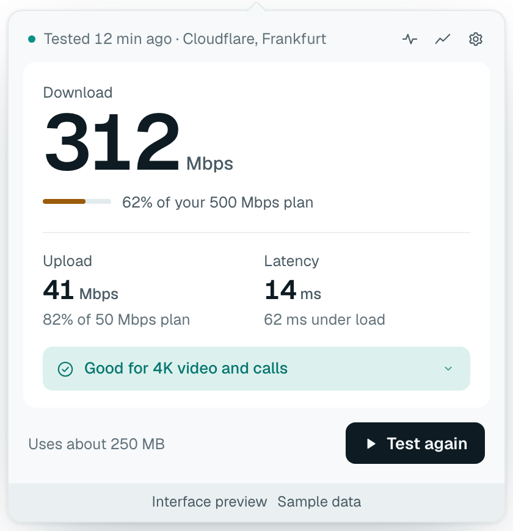
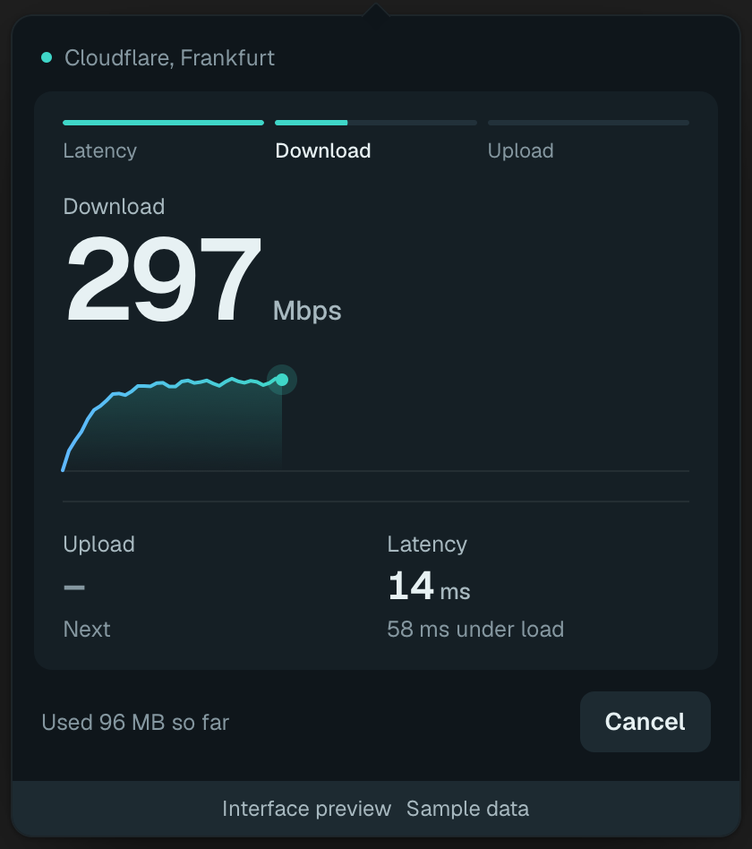
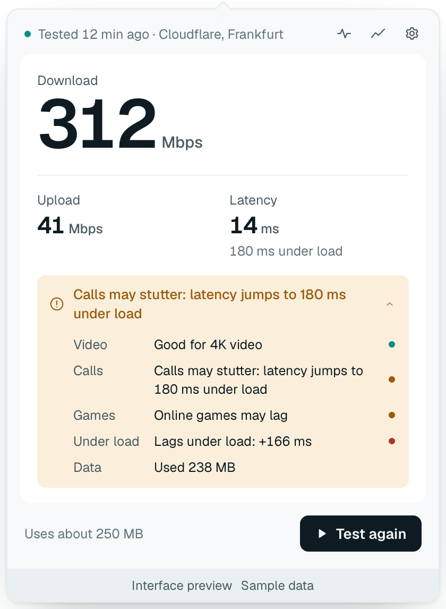
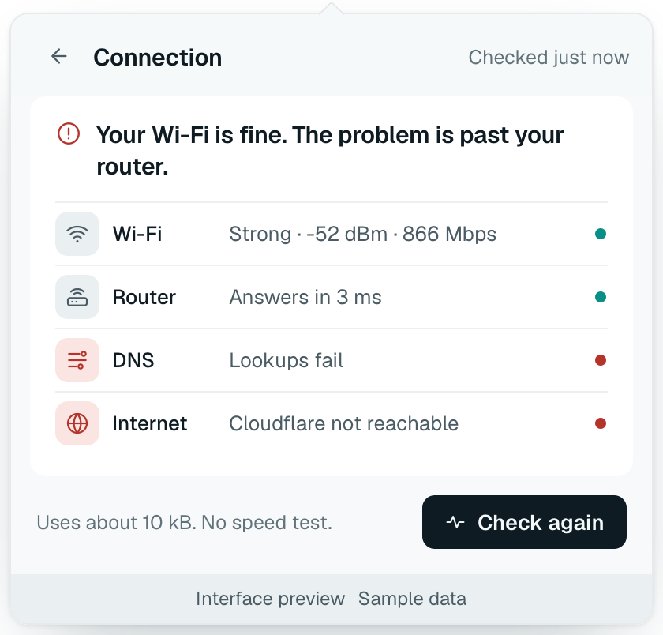
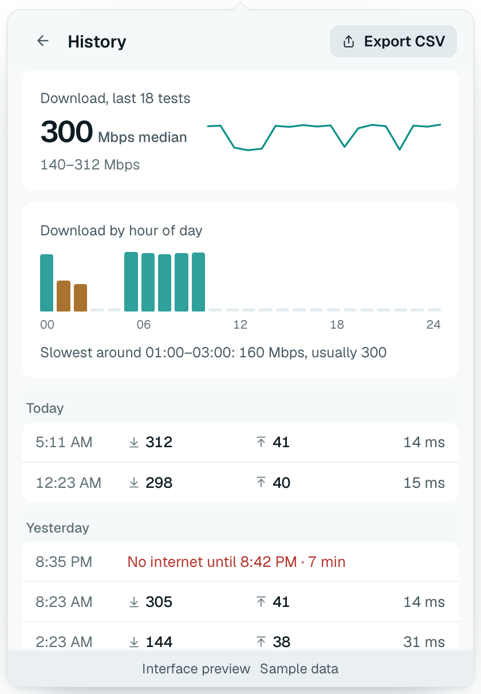

# Weir

**Internet speed in your menu bar.** Test download, upload and latency in one click from the macOS menu bar or the Windows system tray, and see what the numbers mean for video, calls and games.

[Download](https://github.com/Abulkosim/weir/releases/latest) · [Install](#install) · [How it measures](docs/method.md) · [Privacy](PRIVACY.md) · [Changelog](CHANGELOG.md) · [Contributing](CONTRIBUTING.md)

  
  

Interface preview with sample data.

- **One click, about 20 seconds.** Download, upload, latency at rest and under load, and jitter, against Cloudflare. The server and the time are always shown; a failed or cut-short test shows no number.
- **What it means.** "Good for 4K video and calls", or the problem: "Calls may stutter: latency jumps to 180 ms under load".
- **Is it you or the internet?** One check reads your Wi-Fi, router, DNS and Cloudflare and answers in a sentence: "Your Wi-Fi is fine. The problem is past your router."
- **Careful with your data.** The data a test will use is shown before it starts and capped at 600 MB. On a hotspot or metered connection Weir asks first. No accounts, ads or tracking; history stays on your computer.

## Install

Download **v0.3.0** from [GitHub Releases](https://github.com/Abulkosim/weir/releases/latest). Step-by-step guide with uninstall: [docs/install.md](docs/install.md).

| Platform | Download |
| --- | --- |
| macOS 12+ · Apple Silicon and Intel | [Universal DMG](https://github.com/Abulkosim/weir/releases/download/v0.3.0/Weir_0.3.0_universal.dmg) |
| Windows x64 | [Setup EXE](https://github.com/Abulkosim/weir/releases/download/v0.3.0/Weir_0.3.0_x64-setup.exe) · [MSI](https://github.com/Abulkosim/weir/releases/download/v0.3.0/Weir_0.3.0_x64_en-US.msi) |

Builds are not signed with an Apple Developer ID or a Windows publisher certificate, so the first launch shows a warning. Updates are signed and verified in the app.

**macOS.** Drag Weir to Applications and open it. On macOS 15 and later, when **“Weir” Not Opened** appears, click **Done**, then **System Settings → Privacy & Security → Open Anyway**. Weir lives in the menu bar, with no Dock icon. [Details](docs/install.md#macos).

**Windows.** Run the `-setup.exe` (or `.msi`). On **Windows protected your PC**, click **More info → Run anyway**. Smart App Control blocks unsigned apps. [Details](docs/install.md#windows).

**Updates.** Weir checks once a day and installs only when you choose; turn it off in **Settings → Updates**.

## What it shows

  
  
  

- **Result.** Download in large type; upload; idle latency and latency under load; the server, for example "Tested 12 min ago · Cloudflare, Frankfurt".
- **Plain meaning.** Video (Netflix bands), calls (upload, latency under load, jitter), games, and how the line holds up when busy. Thresholds in [docs/method.md](docs/method.md#plain-meaning).
- **Honest labels.** "Varied 52–118 Mbps" when the rate swings, "Stopped at the data limit, speed may be higher", "Over a day old", and a named reason when a test fails.
- **Tray icon.** A small gauge that fills while testing, then shows the last result: full, two thirds or one third for good, fair or poor; crossed out when offline. Hover it for the last numbers; right-click to run a test or check the connection without opening the popover.
- **Keyboard.** ⌘T (Ctrl+T) runs a test, ⌘K (Ctrl+K) checks the connection, ⌘, (Ctrl+,) opens Settings, Esc goes back. **Copy summary** in the result details puts the numbers on the clipboard for a chat with your provider.
- **Check connection.** Wi-Fi signal, router round trip, DNS lookup time and whether Cloudflare answers, each in plain words, about 10 kB, no speed test. Weir never reads your Wi-Fi name.
- **Outages, if you want them.** Settings → Outages → Watch for outages (off by default) sends one tiny request a minute, records "No internet until 14:09 · 7 min" in History, and can notify you when the connection drops and returns.
- **History.** Every test for a year, by day, with the median and range, download by hour of day and the slowest hours named. **Export CSV** from History or Settings, for a spreadsheet or your provider.

## Why Weir

|  | Weir | [fast.com](https://fast.com) | [Speedtest by Ookla](https://www.speedtest.net/apps) | [speed.cloudflare.com](https://speed.cloudflare.com) | macOS `networkQuality` |
| --- | :-: | :-: | :-: | :-: | :-: |
| In the menu bar / tray | ✓ | – | ✓ | – | – |
| macOS and Windows | ✓ | browser | ✓ | browser | macOS |
| Latency under load | ✓ | ✓ | ✓ | ✓ | ✓ (RPM) |
| Says what the result is good for | ✓ | – | – | partly | – |
| Asks before testing on metered links | ✓ | – | – | – | – |
| Is it me or the internet? check | ✓ | – | – | – | – |
| Outage record | opt-in | – | – | – | – |
| Local history and CSV export | ✓ | – | account | – | – |
| No ads, no account, no tracking | ✓ | ✓ | – | ✓ | ✓ |
| Free, open source | MIT | – | – | engine MIT | – |

Numbers differ between tests because servers, stream counts and statistics differ. Weir uses parallel connections and the sustained rate after warm-up, never the peak. [How Weir measures](docs/method.md).

## Privacy

Weir contacts `speed.cloudflare.com` when you run a test or check your connection (and once a minute if you turn on outage watching), your own router and DNS server when you check your connection, and GitHub to check for updates. It sends no telemetry and stores no IP address, location or Wi-Fi name: history keeps the Cloudflare data-centre code and the numbers. Cloudflare sees your IP address, as with any website. Full list: [PRIVACY.md](PRIVACY.md).

## Export

CSV columns: `tested_at` (local time with UTC offset), `result` (`ok`, `failed` or `outage`), `server`, `download_mbps`, `upload_mbps`, `latency_ms`, `latency_under_load_ms`, `jitter_ms`, `download_low_mbps`, `download_high_mbps`, `data_used_mb`, `notes` (for example "stopped at data limit" or the failure reason).

## Develop

See [CONTRIBUTING.md](CONTRIBUTING.md). Releases: [docs/releasing.md](docs/releasing.md). What was verified: [docs/verification.md](docs/verification.md).

Weir is not affiliated with Cloudflare. MIT licensed.
