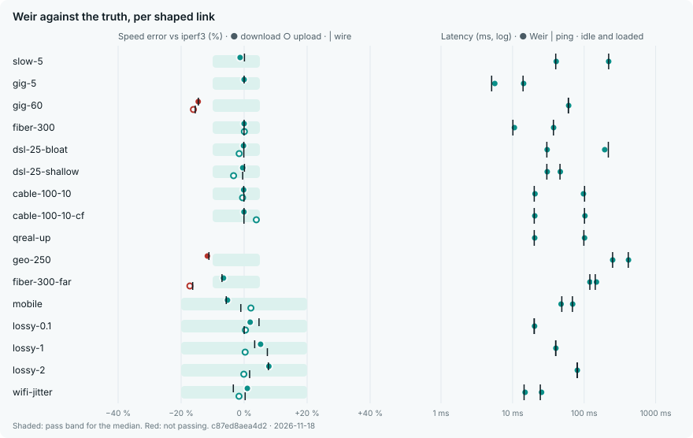

# Accuracy

<!-- Generated by lab/report.ts from docs/accuracy.json. Do not edit; re-run the lab. -->

Generated from [run](https://github.com/Abulkosim/weir/actions/runs/44243331961) on commit `b98c66d0a3cc` (Weir 0.7.3), started 2026-11-18 05:23 UTC.

Gate at run time: **passing**. Re-judged with the findings and rules in this commit: **failing** (they differ: see Findings). 168 pass, 5 fail, 24 expected fail, 6 unexpected pass, 13 invalid input, 115 report only.

<picture>
  <source media="(prefers-color-scheme: dark)" srcset="images/accuracy-dark.svg">
  
</picture>

## How it works

Every engine change runs the real Weir engine (`src-tauri/examples/lab.rs`, the shipped `speedtest::run` with the Cloudflare backend) against a local server on a link shaped on a GitHub-hosted Ubuntu runner.

- **Topology.** Three Linux network namespaces: client, router, server, joined by veth pairs. All shaping sits on the router's two egresses, so the bottleneck queue is a real tail-drop FIFO and not the sender's own TCP Small Queues.
- **Server.** `lab/server`, a small hyper server that speaks the part of Cloudflare's protocol Weir uses (`/cdn-cgi/trace`, `/__down?bytes=N`, `/__up`, `Server-Timing`). It shares no code with Weir.
- **Shaping.** netem adds delay (and loss, and jitter) before a tbf rate limiter whose byte limit is the buffer depth. Offloads (TSO, GSO, GRO) are off, so loss hits single packets and wire counters are per frame.
- **Example, gig-5 download direction:** `tc qdisc add dev rc root handle 1: netem limit 1000000 delay 2.5ms` then `tc qdisc add dev rc parent 1:1 handle 10: tbf rate 1000mbit burst 125000 limit 1250000`.
- **Jitter** uses netem's paretonormal delay with `rate 10gbit`, which keeps packets in order. Loss applies in each direction, to data and ACKs alike.

Four layers of truth, each answering a different question:

| Layer | Truth | Question it answers |
|---|---|---|
| Wire (same run) | Client interface counters (download) and server interface counters (upload) over Weir's own steady window, as TCP payload; a concurrent ping in Weir's own windows | Is Weir's math and counting right for the load it generated? |
| Capacity (interleaved) | iperf3 with the same stream count, in the same repeat | Does Weir's HTTP load fill the link as well as bulk TCP? |
| Physics | The configured shape | Is anything impossible? |
| Twin | Cloudflare's own `@cloudflare/speedtest` in headless Chromium | Does a different method agree? Report only. |

Repeats are interleaved and rotate their order (iperf3, Weir, twin; then Weir, twin, iperf3; …). Every step waits for the queues to drain. CPU is sampled every 250 ms; an iperf3 or Weir step whose busiest CPU was over 95 % busy for any one second is retried once, and if it saturates again its numbers are not judged. The twin step, report only, is judged on its whole-step average because Chromium start-up alone fills a core.

An open finding turns a failing check into an expected failure only within a recorded bound: the ways a run may fail, or the range every per-repeat error must stay in (the worst seen when the bound was set, plus half the check's own limit). A failure outside the bound fails the gate. So does an inconclusive or invalid-input verdict on more than one link, and a check that failed in every run when its bound was set but passes in this run and in the published one: its finding is fixed or wrong.

## Thresholds

Pre-registered before the first run. A failure is a finding, not a reason to move a number.

| Check | Limit | Reason |
|---|---|---|
| downloadWire | maxAbsPct 3 | Same run, same window: the only gap is app-versus-kernel buffering at the window edges plus Weir's 100 ms tick interpolation. |
| uploadWire | maxAbsPct 5 | Weir times whole requests that started in the steady window; the wire is a continuous window. Request edges add a few percent. |
| capacityClean | medianMinPct -10, medianMaxPct 5, worstAbsPct 20 | docs/method.md promises agreement within about 10 %. Over-reading is held tighter because iperf3 already sits near the physical ceiling. |
| capacityNoisy | medianAbsPct 20, worstAbsPct 35 | Loss-limited TCP is high-variance, and HTTP requests recover from tail loss differently from one long bulk transfer. Five repeats, not a wider band, carry the noise. |
| physics | factor 1.02 | No run may report more than the shaped rate can carry (payload per frame, 1448/1514), plus 2 % for tbf burst and window-edge effects. |
| idle | absMs 2, pct 10 | An HTTP probe and an ICMP echo cross the same path; user-space scheduling adds well under 2 ms on an idle host. |
| idleJitter | absMs 3, pct 15 | On a jittery path Weir's 19 probes and the concurrent ping sample different packets of the same delay distribution, so each median carries its own sampling noise. Judged every repeat against the ping taken during Weir's own latency phase: the widest gap in the four runs before this rule was 1.7 ms on wifi-jitter and 3.7 ms on mobile. |
| loaded | absMs 10, pct 15 | Per run. Weir's probes are closed-loop (each waits for the last, every 250 ms at most) and the ping is open-loop at 50 ms, so on a deep queue the two sample different moments of the same sawtooth; a larger gap is Weir's probe method or its runtime scheduling. |
| loadedBias | absMs 5, pct 7.5 | The median of the signed per-run errors, against the median ping. Half the per-run band: sampling noise averages out over repeats, a sampling bias does not. Catches Weir under-reporting bufferbloat while every run stays inside its own band. |
| bloat | fraction 0.8, marginMs 100 | Weir must show bufferbloat that is physically there: at least 80 % of the rise a concurrent ping sees on the deep buffer, and clearly more than on the shallow one. |
| dataCeiling | mb 600 | Before a first result the app promises a test uses up to 600 MB (data_estimate UpTo). Counted as IP-layer bytes on the client interface over the whole run. |
| baseline | minMbps 1500, maxServerCoresPerGbps 0.5, maxInflationMs 1 | Unshaped, iperf3 and Weir must carry 1.5× the fastest shaped link and the lab server must need under half a core per Gbps (the spike measured about a quarter), or the 1 Gbps profiles would judge the lab instead of Weir. |
| unjudged | maxLinks 1 | Inconclusive and invalid-input verdicts mean the lab could not judge a link, not that Weir is wrong, so they warn. One such link per run is lab noise (the eighth run: one fiber-300-far iperf3 run read 1.016 of the ceiling); two or more mean the lab itself is off, and the gate fails. |
| noise | fractionOfBand 0.5 | When the truth itself moves by more than half the band between repeats, a pass or fail would be luck. The result is inconclusive and the fix is in the lab. |
| rate | min 0.93, max 1.015 | Loss-free iperf3 goodput over the shaped payload ceiling. Below 0.93 the shaper or host is not delivering the configured rate; above 1.015 the shaper leaks. Raised from 1.005 after the first three runs: iperf3 read up to 1.1 % over the ceiling on 5–25 Mbps links whose tbf rate is exact, which is iperf3 interval timing, not a leak. The upper bound applies to the median run per direction since the eighth run (fiber-300-far read 1.016 once and 0.999 twice: a leaking shaper leaks every run). The lower bound applies to the best iperf3 run per direction since the seventh run: one gig-60 upload run reached 0.81 while the others reached 0.99, which is TCP on a shallow buffer, not the shaper; such an under-filling run is not used as capacity truth. |
| iperfConsistency | maxPct 2 | iperf3's receiver intervals must agree with its own end total, or that run is not used as truth. Raised from 1 % after the first three runs: a 600 ms buffer upload disagreed by 1.06 %, the queue draining after the sender stops; the speed bands are ten times wider. |
| jitterDelay | medianAbsMs 1.5, medianPct 10, p95Spreads 4, minSpreadMs 2 | netem's paretonormal delay is centred on the configured delay and spreads both ways. On the spike the idle p95 sat 1.9 and 2.5 spreads above the round trip, so 4 spreads bounds it; a p95 − p5 under 2 ms means the jitter is missing. |
| bloatInput | deepFraction 0.6, shallowSlackMs 10 | Under iperf3, cubic's sawtooth keeps the median queue at about three quarters of a deep buffer (spike: 0.75 down, 0.88 up), so 0.6 proves the buffer fills; a shallow buffer may add its own depth plus 10 ms. |
| delay | absMs 0.5, pct 3 | Idle ping must match the configured netem delay before any number from that link is trusted. |

## Summary

| Link | Download vs iperf3 | Upload vs iperf3 | Idle latency | Loaded latency | Data | Status |
|---|---|---|---|---|---|---|
| [slow-5](#slow-5) | +0.1 % (−0.9 to +0.3) | – | +0.3 ms (+0.3 to +0.3) | −0.1 ms (−1.2 to +1.7) / – | 4 MB (4–4) | expected fail (validity) |
| [gig-5](#gig-5) | +0.0 % (−0.0 to +0.0) | – | +0.3 ms (+0.2 to +0.3) | +0.4 ms (+0.4 to +0.6) / – | 606 MB (605–609) | expected fail (validity) |
| [gig-60](#gig-60) | −10.1 % (−22.1 to −6.0) | −18.9 % (−20.1 to −15.6) | +0.4 ms (+0.3 to +0.4) | +1.2 ms (−1.0 to +3.5) / +0.3 ms (+0.2 to +0.3) | 616 MB (612–618) | expected fail (download.capacity) |
| [fiber-300](#fiber-300) | −0.0 % (−0.0 to −0.0) | +0.2 % (+0.1 to +0.5) | +0.3 ms (+0.2 to +0.3) | −0.4 ms (−1.0 to −0.2) / −0.5 ms (−0.7 to +0.6) | 393 MB (392–395) | pass |
| [dsl-25-bloat](#dsl-25-bloat) | −0.1 % (−0.3 to −0.1) | −0.9 % (−1.6 to +0.2) | +0.2 ms (+0.2 to +0.3) | −10.2 ms (−13.4 to −4.7) / −18.8 ms (−21.9 to −11.9) | 23 MB (23–23) | unexpected pass (loaded.download.bias) |
| [dsl-25-shallow](#dsl-25-shallow) | −0.1 % (−0.4 to +0.2) | +2.9 % (+2.0 to +3.0) | +0.3 ms (+0.3 to +0.3) | +0.8 ms (−0.5 to +2.2) / +1.2 ms (−1.3 to +1.6) | 22 MB (22–22) | **fail** (upload.physics) |
| [cable-100-10](#cable-100-10) | −0.1 % (−0.1 to −0.0) | +0.5 % (+0.1 to +0.6) | +0.2 ms (+0.2 to +0.3) | −2.2 ms (−2.5 to +0.3) / −0.5 ms (−1.9 to −0.2) | 75 MB (75–75) | pass |
| [cable-100-10-cf](#cable-100-10-cf) | −0.1 % (−0.1 to +0.1) | +3.7 % (+3.6 to +4.3) | +0.4 ms (+0.3 to +0.4) | +1.7 ms (−2.9 to +2.6) / +2.5 ms (+0.1 to +2.6) | 75 MB (73–75) | **fail** (upload.physics) |
| [qreal-up](#qreal-up) | – | – | +0.3 ms (+0.2 to +0.3) | +0.3 ms (−0.7 to +3.3) / +0.6 ms (−0.2 to +1.3) | 75 MB (74–75) | pass |
| [geo-250](#geo-250) | −2.2 % (−12.7 to −0.4) | – | +0.5 ms (+0.4 to +0.5) | +4.9 ms (−5.9 to +11.7) / – | 22 MB (21–28) | expected fail (validity) |
| [fiber-300-far](#fiber-300-far) | −7.4 % (−9.1 to −2.9) | −17.5 % (−18.5 to −12.8) | +0.4 ms (+0.4 to +0.4) | +1.2 ms (+0.6 to +3.8) / +0.1 ms (−4.8 to +0.3) | 245 MB (244–260) | unexpected pass (download.capacity) |
| [mobile](#mobile) | −7.1 % (−16.0 to +14.9) | +2.7 % (−1.4 to +4.7) | +1.6 ms (−1.4 to +4.6) | −0.8 ms (−9.6 to +1.3) / +6.5 ms (−4.5 to +18.5) | 25 MB (19–28) | **fail** (upload.wire) |
| [lossy-0.1](#lossy-01) | +6.5 % (−2.1 to +17.3) | +0.1 % (−0.5 to +0.4) | +0.3 ms (+0.2 to +0.3) | +0.2 ms (+0.2 to +0.2) / +1.2 ms (−0.2 to +1.3) | 225 MB (156–249) | pass |
| [lossy-1](#lossy-1) | +9.2 % (+4.4 to +15.8) | +8.6 % (−1.9 to +26.0) | +0.3 ms (+0.3 to +0.3) | +0.2 ms (+0.2 to +0.2) / +0.3 ms (+0.2 to +0.3) | 35 MB (30–36) | pass |
| [lossy-2](#lossy-2) | +6.0 % (−5.7 to +12.8) | +3.0 % (−11.8 to +7.8) | +0.4 ms (+0.3 to +0.4) | +0.3 ms (+0.2 to +0.3) / +0.8 ms (−2.3 to +2.4) | 14 MB (11–14) | **fail** (upload.wire) |
| [wifi-jitter](#wifi-jitter) | +1.7 % (−11.9 to +38.1) | −2.4 % (−10.2 to +4.7) | +0.3 ms (−1.4 to +1.3) | −0.2 ms (−0.7 to +1.5) / −0.2 ms (−1.3 to +2.6) | 94 MB (81–113) | **invalid input** (validity) |

Errors are Weir minus the truth: percent of iperf3 for speeds, ms against a ping for latency.

## Links

### slow-5

Slow DSL, 5/1 Mbps. 5/1 Mbps · 40 ms RTT · 200 ms buffer.

3 runs of Weir and iperf3, 3 of the twin, on shard 1 (AMD EPYC 9V45 96-Core Processor). Cells show the median and (range).

| | Wire | iperf3 | Weir | Twin | Weir error | Status |
|---|---|---|---|---|---|---|
| Download | 4.8 Mbps | 4.8 Mbps (4.7–4.8) | 4.8 Mbps (4.7–4.8) | 4.7 Mbps | −0.3 % (−1.2 to −0.1) wire, +0.1 % (−0.9 to +0.3) iperf3 | unexpected pass ([F-9](#f-9)) |
| Upload | – | 0.9 Mbps (0.9–0.9) | – | 1.0 Mbps | – wire, – iperf3 | expected fail ([F-2](#f-2)) |
| Idle latency | – | 40.1 ms ping | 40.4 ms (40.4–40.4) | 40.2 ms | +0.3 ms (+0.3 to +0.3) | pass |
| Loaded latency, download | 226 ms (223–226) ping | – | 225 ms (222–228) | – | −0.1 ms (−1.2 to +1.7) | pass |
| Loaded latency, upload | 225 ms (223–227) ping | – | – | – | – | expected fail ([F-2](#f-2)) |
| Jitter | – | 0.04 ms (0.01–0.04) ping | 0.05 ms (0.04–0.05) | – | – | report only |
| Data used | 4 MB (4–4) on the wire | – | counts 101 % of the payload | – | – | pass |

- Validity: Weir did not finish every run: upload stalled ×3 in 3 runs. expected fail ([F-2](#f-2)).
- download.wire: worst 1.2 % against the wire in Weir's own steady window (limit 3 %). unexpected pass ([F-9](#f-9)).
- upload.wire: no Weir result to compare with the wire. Suspect: weir-math. expected fail ([F-2](#f-2)).
- upload.capacity: too few runs with both Weir and iperf3. Suspect: weir-math. expected fail ([F-2](#f-2)).
- upload.physics: no Weir result. Suspect: weir-math. expected fail ([F-2](#f-2)).
- loaded.upload: no loaded latency to compare. Suspect: weir-math. expected fail ([F-2](#f-2)).
- loaded.upload.bias: no loaded latency to compare. Suspect: weir-math. expected fail ([F-2](#f-2)).

### gig-5

Gigabit fibre, near. 1000/1000 Mbps · 5 ms RTT · 10 ms buffer.

3 runs of Weir and iperf3, 3 of the twin, on shard 1 (AMD EPYC 9V45 96-Core Processor). Cells show the median and (range).

| | Wire | iperf3 | Weir | Twin | Weir error | Status |
|---|---|---|---|---|---|---|
| Download | 956.4 Mbps (956.4–956.4) | 956.3 Mbps (956.3–956.4) | 956.5 Mbps (956.4–956.5) | 937.2 Mbps (937.0–937.2) | +0.0 % (−0.0 to +0.0) wire, +0.0 % (−0.0 to +0.0) iperf3 | pass |
| Upload | – | 956.3 Mbps (955.8–956.3) | – | 913.8 Mbps (906.8–915.7) | – wire, – iperf3 | expected fail ([F-1](#f-1)) |
| Idle latency | – | 5.1 ms ping | 5.3 ms (5.3–5.3) | 5.1 ms (5.1–5.2) | +0.3 ms (+0.2 to +0.3) | pass |
| Loaded latency, download | 14 ms (14–14) ping | – | 14 ms (14–14) | – | +0.4 ms (+0.4 to +0.6) | pass |
| Loaded latency, upload | 13 ms (13–14) ping | – | – | – | – | expected fail ([F-1](#f-1)) |
| Jitter | – | 0.01 ms (0.01–0.01) ping | 0.03 ms (0.02–0.04) | – | – | report only |
| Data used | 606 MB (605–609) on the wire | – | counts 100 % of the payload | – | – | expected fail ([F-3](#f-3)) |

- Validity: Weir did not finish every run: upload tooShort ×3 in 3 runs. expected fail ([F-1](#f-1)).
- upload.wire: no Weir result to compare with the wire. Suspect: weir-math. expected fail ([F-1](#f-1)).
- upload.capacity: too few runs with both Weir and iperf3. Suspect: weir-math. expected fail ([F-1](#f-1)).
- upload.physics: no Weir result. Suspect: weir-math. expected fail ([F-1](#f-1)).
- loaded.upload: no loaded latency to compare. Suspect: weir-math. expected fail ([F-1](#f-1)).
- loaded.upload.bias: no loaded latency to compare. Suspect: weir-math. expected fail ([F-1](#f-1)).
- data.ceiling: most 609 MB on the wire (promise: up to 600 MB). Suspect: weir-math. expected fail ([F-3](#f-3)).

### gig-60

Gigabit, 60 ms away. 1000/500 Mbps · 60 ms RTT · 20 ms buffer.

3 runs of Weir and iperf3, 3 of the twin, on shard 1 (AMD EPYC 9V45 96-Core Processor). Cells show the median and (range).

| | Wire | iperf3 | Weir | Twin | Weir error | Status |
|---|---|---|---|---|---|---|
| Download | 859.6 Mbps (745.1–888.0) | 955.7 Mbps (949.0–956.5) | 859.7 Mbps (744.7–892.3) | 296.0 Mbps (281.3–296.9) | +0.0 % (−0.1 to +0.5) wire, −10.1 % (−22.1 to −6.0) iperf3 | expected fail ([F-4](#f-4)) |
| Upload | 387.2 Mbps (376.9–404.8) | 478.1 Mbps (476.3–478.2) | 387.7 Mbps (380.4–403.7) | 218.1 Mbps (208.7–236.9) | +0.1 % (−0.3 to +0.9) wire, −18.9 % (−20.1 to −15.6) iperf3 | expected fail ([F-4](#f-4)) |
| Idle latency | – | 60.1 ms ping | 60.5 ms (60.4–60.5) | 60.3 ms | +0.4 ms (+0.3 to +0.4) | pass |
| Loaded latency, download | 62 ms (60–67) ping | – | 61 ms (61–70) | – | +1.2 ms (−1.0 to +3.5) | pass |
| Loaded latency, upload | 60 ms (60–60) ping | – | 60 ms (60–60) | – | +0.3 ms (+0.2 to +0.3) | pass |
| Jitter | – | 0.02 ms (0.00–0.02) ping | 0.04 ms (0.04–0.06) | – | – | report only |
| Data used | 616 MB (612–618) on the wire | – | counts 98 % of the payload | – | – | expected fail ([F-3](#f-3)) |

- Validity: 3 of 3 runs finished with a download and an upload. pass.
- download.capacity: median -10.1 %, worst 22.1 % against iperf3 (median -10 % to +5 %, worst within 20 %); truth noise 0.8 %. Suspect: weir-load. expected fail ([F-4](#f-4)).
- upload.capacity: median -18.9 %, worst 20.1 % against iperf3 (median -10 % to +5 %, worst within 20 %); truth noise 0.4 %. Suspect: weir-load. expected fail ([F-4](#f-4)).
- data.ceiling: most 618 MB on the wire (promise: up to 600 MB). Suspect: weir-math. expected fail ([F-3](#f-3)).

### fiber-300

Fibre 300/300. 300/300 Mbps · 10 ms RTT · 30 ms buffer.

3 runs of Weir and iperf3, 3 of the twin, on shard 1 (AMD EPYC 9V45 96-Core Processor). Cells show the median and (range).

| | Wire | iperf3 | Weir | Twin | Weir error | Status |
|---|---|---|---|---|---|---|
| Download | 286.9 Mbps (286.9–286.9) | 286.9 Mbps (286.9–286.9) | 286.9 Mbps (286.8–286.9) | 283.1 Mbps (282.1–283.2) | −0.0 % (−0.0 to −0.0) wire, −0.0 % (−0.0 to −0.0) iperf3 | pass |
| Upload | 286.9 Mbps (286.9–286.9) | 286.9 Mbps (286.4–287.0) | 287.3 Mbps (287.1–288.2) | 279.1 Mbps (279.0–280.2) | +0.1 % (+0.1 to +0.4) wire, +0.2 % (+0.1 to +0.5) iperf3 | pass |
| Idle latency | – | 10.1 ms ping | 10.4 ms (10.3–10.4) | 10.2 ms | +0.3 ms (+0.2 to +0.3) | pass |
| Loaded latency, download | 37 ms (36–38) ping | – | 37 ms (35–38) | – | −0.4 ms (−1.0 to −0.2) | pass |
| Loaded latency, upload | 37 ms (37–37) ping | – | 36 ms (36–37) | – | −0.5 ms (−0.7 to +0.6) | pass |
| Jitter | – | 0.00 ms ping | 0.05 ms (0.04–0.07) | – | – | report only |
| Data used | 393 MB (392–395) on the wire | – | counts 100 % of the payload | – | – | pass |

- Validity: 3 of 3 runs finished with a download and an upload. pass.

### dsl-25-bloat

DSL 25/5, deep buffer. 25/5 Mbps · 30 ms RTT · 600 ms buffer.

3 runs of Weir and iperf3, 3 of the twin, on shard 2 (AMD EPYC 9V45 96-Core Processor). Cells show the median and (range).

| | Wire | iperf3 | Weir | Twin | Weir error | Status |
|---|---|---|---|---|---|---|
| Download | 23.9 Mbps (23.9–23.9) | 23.9 Mbps (23.9–23.9) | 23.9 Mbps (23.9–23.9) | 23.6 Mbps (23.6–23.6) | −0.1 % (−0.1 to −0.1) wire, −0.1 % (−0.3 to −0.1) iperf3 | pass |
| Upload | 4.8 Mbps (4.8–4.8) | 4.8 Mbps | 4.7 Mbps (4.7–4.8) | 4.7 Mbps | −1.0 % (−1.6 to +0.1) wire, −0.9 % (−1.6 to +0.2) iperf3 | pass |
| Idle latency | – | 30.1 ms (30.0–30.1) ping | 30.3 ms (30.2–30.4) | 30.2 ms | +0.2 ms (+0.2 to +0.3) | pass |
| Loaded latency, download | 214 ms (212–238) ping | – | 209 ms (202–225) | – | −10.2 ms (−13.4 to −4.7) | pass |
| Loaded latency, upload | 402 ms (401–412) ping | – | 389 ms (383–390) | – | −18.8 ms (−21.9 to −11.9) | pass |
| Jitter | – | 0.01 ms (0.00–0.05) ping | 0.07 ms (0.05–0.15) | – | – | report only |
| Data used | 23 MB (23–23) on the wire | – | counts 95 % of the payload | – | – | pass |

- Validity: 3 of 3 runs finished with a download and an upload. pass.
- Bloat: Weir's latency rises 359 ms under load (concurrent ping 372 ms; shallow buffer 16 ms). pass.
- loaded.download.bias: median signed error -10.2 ms over 3 runs against a 214 ms ping (limit ±16.0 ms). unexpected pass ([F-8](#f-8)).

### dsl-25-shallow

DSL 25/5, shallow buffer. 25/5 Mbps · 30 ms RTT · 20 ms buffer.

3 runs of Weir and iperf3, 3 of the twin, on shard 2 (AMD EPYC 9V45 96-Core Processor). Cells show the median and (range).

| | Wire | iperf3 | Weir | Twin | Weir error | Status |
|---|---|---|---|---|---|---|
| Download | 23.9 Mbps (23.9–23.9) | 23.9 Mbps (23.8–23.9) | 23.9 Mbps (23.8–23.9) | 23.4 Mbps (23.4–23.5) | −0.1 % (−0.2 to −0.0) wire, −0.1 % (−0.4 to +0.2) iperf3 | pass |
| Upload | 4.8 Mbps (4.7–4.8) | 4.8 Mbps (4.8–4.8) | 4.9 Mbps (4.9–4.9) | 4.6 Mbps (4.6–4.6) | +3.2 % (+2.2 to +3.4) wire, +2.9 % (+2.0 to +3.0) iperf3 | **fail** |
| Idle latency | – | 30.1 ms ping | 30.4 ms (30.4–30.4) | 30.2 ms | +0.3 ms (+0.3 to +0.3) | pass |
| Loaded latency, download | 46 ms (45–47) ping | – | 47 ms (46–47) | – | +0.8 ms (−0.5 to +2.2) | pass |
| Loaded latency, upload | 44 ms (43–44) ping | – | 45 ms (43–45) | – | +1.2 ms (−1.3 to +1.6) | pass |
| Jitter | – | 0.00 ms (0.00–0.05) ping | 0.08 ms (0.03–0.08) | – | – | report only |
| Data used | 22 MB (22–22) on the wire | – | counts 99 % of the payload | – | – | pass |

- Validity: 3 of 3 runs finished with a download and an upload. pass.
- upload.physics: highest 4.9 Mbps; the link can carry 4.9 Mbps. Suspect: weir-math. **fail**.

### cable-100-10

Cable 100/10. 100/10 Mbps · 20 ms RTT · 100 ms buffer.

3 runs of Weir and iperf3, 3 of the twin, on shard 2 (AMD EPYC 9V45 96-Core Processor). Cells show the median and (range).

| | Wire | iperf3 | Weir | Twin | Weir error | Status |
|---|---|---|---|---|---|---|
| Download | 95.6 Mbps (95.6–95.6) | 95.7 Mbps (95.6–95.7) | 95.6 Mbps (95.6–95.6) | 93.9 Mbps (93.5–93.9) | −0.0 % (−0.0 to −0.0) wire, −0.1 % (−0.1 to −0.0) iperf3 | pass |
| Upload | 9.6 Mbps (9.5–9.6) | 9.5 Mbps (9.5–9.5) | 9.6 Mbps (9.6–9.6) | 9.6 Mbps | +0.2 % (+0.0 to +0.4) wire, +0.5 % (+0.1 to +0.6) iperf3 | pass |
| Idle latency | – | 20.1 ms ping | 20.3 ms (20.3–20.4) | 20.2 ms (20.1–20.2) | +0.2 ms (+0.2 to +0.3) | pass |
| Loaded latency, download | 104 ms (104–105) ping | – | 102 ms (101–105) | – | −2.2 ms (−2.5 to +0.3) | pass |
| Loaded latency, upload | 107 ms (105–109) ping | – | 106 ms (105–107) | – | −0.5 ms (−1.9 to −0.2) | pass |
| Jitter | – | 0.00 ms (0.00–0.02) ping | 0.10 ms (0.04–0.13) | – | – | report only |
| Data used | 75 MB (75–75) on the wire | – | counts 98 % of the payload | – | – | pass |

- Validity: 3 of 3 runs finished with a download and an upload. pass.

### cable-100-10-cf

Cable 100/10, 30 ms server time. 100/10 Mbps · 20 ms RTT · 100 ms buffer · 30 ms server time.

3 runs of Weir and iperf3, 3 of the twin, on shard 2 (AMD EPYC 9V45 96-Core Processor). Cells show the median and (range).

| | Wire | iperf3 | Weir | Twin | Weir error | Status |
|---|---|---|---|---|---|---|
| Download | 95.6 Mbps (95.6–95.6) | 95.6 Mbps (95.5–95.7) | 95.6 Mbps (95.5–95.6) | 93.5 Mbps (93.5–93.5) | −0.0 % (−0.0 to −0.0) wire, −0.1 % (−0.1 to +0.1) iperf3 | pass |
| Upload | 9.6 Mbps | 9.6 Mbps (9.6–9.6) | 9.9 Mbps (9.9–10.0) | 9.5 Mbps | +3.8 % (+3.8 to +4.6) wire, +3.7 % (+3.6 to +4.3) iperf3 | **fail** |
| Idle latency | – | 20.1 ms ping | 20.5 ms (20.4–20.5) | 20.2 ms (20.2–20.2) | +0.4 ms (+0.3 to +0.4) | pass |
| Loaded latency, download | 99 ms (97–103) ping | – | 100 ms (99–101) | – | +1.7 ms (−2.9 to +2.6) | pass |
| Loaded latency, upload | 103 ms (100–105) ping | – | 103 ms (103–107) | – | +2.5 ms (+0.1 to +2.6) | pass |
| Jitter | – | 0.00 ms (0.00–0.02) ping | 0.04 ms (0.04–0.11) | – | – | report only |
| Data used | 75 MB (73–75) on the wire | – | counts 98 % of the payload | – | – | pass |

- Validity: 3 of 3 runs finished with a download and an upload. pass.
- upload.physics: highest 10.0 Mbps; the link can carry 9.8 Mbps. Suspect: weir-math. **fail**.

### qreal-up

Cable 100/10, upload server time includes the body. 100/10 Mbps · 20 ms RTT · 100 ms buffer · 30 ms server time · upload Server-Timing includes the body.

3 runs of Weir, on shard 2 (AMD EPYC 9V45 96-Core Processor). Cells show the median and (range).

| | Wire | iperf3 | Weir | Twin | Weir error | Status |
|---|---|---|---|---|---|---|
| Download | 95.5 Mbps (95.5–95.6) | – | 95.5 Mbps (95.5–95.6) | – | −0.0 % (−0.0 to −0.0) wire, – iperf3 | report only |
| Upload | 9.6 Mbps (9.6–9.6) | – | 19.1 Mbps (19.1–19.2) | – | +99.8 % (+99.8 to +100.5) wire, – iperf3 | report only |
| Idle latency | – | 20.1 ms ping | 20.4 ms (20.3–20.4) | – | +0.3 ms (+0.2 to +0.3) | report only |
| Loaded latency, download | 98 ms (95–99) ping | – | 97 ms (95–102) | – | +0.3 ms (−0.7 to +3.3) | report only |
| Loaded latency, upload | 104 ms (102–104) ping | – | 104 ms (102–105) | – | +0.6 ms (−0.2 to +1.3) | report only |
| Jitter | – | – ping | 0.13 ms (0.05–0.14) | – | – | report only |
| Data used | 75 MB (74–75) on the wire | – | counts 98 % of the payload | – | – | report only |

- Validity: 3 of 3 runs finished with a download and an upload (report only). report only.
- Q-real: Weir's upload reads 19.1 Mbps when Server-Timing includes the body, +92.5 % against 9.9 Mbps on the same link when it does not. report only.

### geo-250

Satellite-like, 250 ms. 25/3 Mbps · 250 ms RTT · 300 ms buffer.

3 runs of Weir and iperf3, 3 of the twin, on shard 3 (AMD EPYC 7763 64-Core Processor). Cells show the median and (range).

| | Wire | iperf3 | Weir | Twin | Weir error | Status |
|---|---|---|---|---|---|---|
| Download | 23.4 Mbps (21.8–23.8) | 23.9 Mbps (23.9–23.9) | 23.4 Mbps (20.8–23.8) | 22.2 Mbps (22.2–22.2) | −0.4 % (−4.6 to −0.1) wire, −2.2 % (−12.7 to −0.4) iperf3 | expected fail ([F-7](#f-7)) |
| Upload | – | 2.9 Mbps (2.9–2.9) | – | 2.6 Mbps | – wire, – iperf3 | expected fail ([F-2](#f-2)) |
| Idle latency | – | 250.0 ms ping | 250.5 ms (250.4–250.5) | 250.3 ms (250.3–250.4) | +0.5 ms (+0.4 to +0.5) | pass |
| Loaded latency, download | 434 ms (429–457) ping | – | 446 ms (423–461) | – | +4.9 ms (−5.9 to +11.7) | unexpected pass ([F-8](#f-8)) |
| Loaded latency, upload | 541 ms (540–542) ping | – | – | – | – | expected fail ([F-2](#f-2)) |
| Jitter | – | 0.00 ms ping | 0.05 ms (0.03–0.06) | – | – | report only |
| Data used | 22 MB (21–28) on the wire | – | counts 91 % of the payload | – | – | pass |

- Validity: Weir did not finish every run: upload stalled ×3 in 3 runs. expected fail ([F-2](#f-2)).
- download.wire: worst 4.6 % against the wire in Weir's own steady window (limit 3 %). Suspect: weir-math. expected fail ([F-7](#f-7)).
- download.capacity: median -2.2 %, worst 12.7 % against iperf3 (median -10 % to +5 %, worst within 20 %); truth noise 0.1 %. unexpected pass ([F-6](#f-6)).
- upload.wire: no Weir result to compare with the wire. Suspect: weir-math. expected fail ([F-2](#f-2)).
- upload.capacity: too few runs with both Weir and iperf3. Suspect: weir-math. expected fail ([F-2](#f-2)).
- upload.physics: no Weir result. Suspect: weir-math. expected fail ([F-2](#f-2)).
- loaded.download: worst 11.7 ms from a concurrent ping in Weir's window (limit max(10 ms, 15 %)). unexpected pass ([F-8](#f-8)).
- loaded.download.bias: median signed error 4.9 ms over 3 runs against a 434 ms ping (limit ±32.5 ms). unexpected pass ([F-8](#f-8)).
- loaded.upload: no loaded latency to compare. Suspect: weir-math. expected fail ([F-2](#f-2)).
- loaded.upload.bias: no loaded latency to compare. Suspect: weir-math. expected fail ([F-2](#f-2)).

### fiber-300-far

Fibre 300/100, 120 ms away. 300/100 Mbps · 120 ms RTT · 50 ms buffer.

3 runs of Weir and iperf3, 3 of the twin, on shard 3 (AMD EPYC 7763 64-Core Processor). Cells show the median and (range).

| | Wire | iperf3 | Weir | Twin | Weir error | Status |
|---|---|---|---|---|---|---|
| Download | 269.3 Mbps (264.4–278.4) | 290.9 Mbps (286.9–291.0) | 269.3 Mbps (264.4–278.4) | 104.3 Mbps (103.4–105.6) | −0.0 % (−0.0 to −0.0) wire, −7.4 % (−9.1 to −2.9) iperf3 | unexpected pass ([F-6](#f-6)) |
| Upload | 78.1 Mbps (76.9–80.0) | 95.6 Mbps (95.5–95.7) | 78.8 Mbps (78.0–83.4) | 35.1 Mbps (35.1–58.4) | +2.5 % (−0.2 to +4.3) wire, −17.5 % (−18.5 to −12.8) iperf3 | expected fail ([F-6](#f-6)) |
| Idle latency | – | 120.0 ms ping | 120.4 ms (120.4–120.4) | 120.3 ms | +0.4 ms (+0.4 to +0.4) | pass |
| Loaded latency, download | 136 ms (128–144) ping | – | 137 ms (132–145) | – | +1.2 ms (+0.6 to +3.8) | pass |
| Loaded latency, upload | 126 ms (120–129) ping | – | 121 ms (120–129) | – | +0.1 ms (−4.8 to +0.3) | pass |
| Jitter | – | 0.00 ms ping | 0.05 ms (0.04–0.05) | – | – | report only |
| Data used | 245 MB (244–260) on the wire | – | counts 97 % of the payload | – | – | pass |

- Validity: 3 of 3 runs finished with a download and an upload. pass.
- download.capacity: median -7.4 %, worst 9.1 % against iperf3 (median -10 % to +5 %, worst within 20 %); truth noise 1.4 %. unexpected pass ([F-6](#f-6)).
- upload.capacity: median -17.5 %, worst 18.5 % against iperf3 (median -10 % to +5 %, worst within 20 %); truth noise 0.2 %. Suspect: weir-load. expected fail ([F-6](#f-6)).

### mobile

Mobile 30/8, jittery, 0.5% loss. 30/8 Mbps · 50 ms RTT · 0.5 % loss each way · 300 ms buffer · jitter 6 ms each way · 25 ms server time.

5 runs of Weir and iperf3, 3 of the twin, on shard 3 (AMD EPYC 7763 64-Core Processor). Cells show the median and (range).

| | Wire | iperf3 | Weir | Twin | Weir error | Status |
|---|---|---|---|---|---|---|
| Download | 17.9 Mbps (15.8–18.4) | 18.4 Mbps (15.6–19.8) | 17.8 Mbps (15.8–18.4) | 5.7 Mbps (3.7–6.5) | −0.0 % (−0.1 to +0.2) wire, −7.1 % (−16.0 to +14.9) iperf3 | pass |
| Upload | 7.6 Mbps (7.6–7.6) | 7.6 Mbps (7.6–7.6) | 7.8 Mbps (7.5–8.0) | 4.6 Mbps (4.2–6.4) | +3.0 % (−1.5 to +5.3) wire, +2.7 % (−1.4 to +4.7) iperf3 | **fail** |
| Idle latency | – | 48.5 ms (47.3–49.7) ping | 50.1 ms (47.8–53.2) | 49.4 ms (47.9–49.4) | +1.6 ms (−1.4 to +4.6) | pass |
| Loaded latency, download | 70 ms (68–72) ping | – | 69 ms (60–70) | – | −0.8 ms (−9.6 to +1.3) | pass |
| Loaded latency, upload | 129 ms (118–175) ping | – | 144 ms (114–193) | – | +6.5 ms (−4.5 to +18.5) | pass |
| Jitter | – | 6.87 ms (6.02–9.47) ping | 7.06 ms (4.69–8.56) | – | – | report only |
| Data used | 25 MB (19–28) on the wire | – | counts 99 % of the payload | – | – | pass |

- Validity: 5 of 5 runs finished with a download and an upload. pass.
- upload.wire: worst 5.3 % against the wire in Weir's own steady window (limit 5 %). Suspect: weir-math. **fail**.
- upload.physics: highest 8.0 Mbps; the link can carry 7.8 Mbps. Suspect: weir-math. **fail**.

### lossy-0.1

Fibre 300/50, 0.1% loss. 300/50 Mbps · 20 ms RTT · 0.1 % loss each way · 30 ms buffer.

5 runs of Weir and iperf3, 3 of the twin, on shard 4 (AMD EPYC 9V74 80-Core Processor). Cells show the median and (range).

| | Wire | iperf3 | Weir | Twin | Weir error | Status |
|---|---|---|---|---|---|---|
| Download | 141.7 Mbps (133.6–144.1) | 133.1 Mbps (122.8–138.1) | 141.7 Mbps (133.6–144.1) | 41.4 Mbps (36.5–153.9) | +0.0 % (−0.0 to +0.1) wire, +6.5 % (−2.1 to +17.3) iperf3 | pass |
| Upload | 47.7 Mbps (47.7–47.8) | 47.8 Mbps (47.8–47.8) | 47.8 Mbps (47.6–48.0) | 34.9 Mbps (33.6–43.1) | +0.0 % (−0.3 to +0.7) wire, +0.1 % (−0.5 to +0.4) iperf3 | pass |
| Idle latency | – | 20.1 ms ping | 20.4 ms (20.3–20.4) | 20.2 ms (20.1–20.2) | +0.3 ms (+0.2 to +0.3) | pass |
| Loaded latency, download | 20 ms ping | – | 20 ms (20–20) | – | +0.2 ms (+0.2 to +0.2) | pass |
| Loaded latency, upload | 36 ms (30–40) ping | – | 36 ms (30–41) | – | +1.2 ms (−0.2 to +1.3) | pass |
| Jitter | – | 0.00 ms (0.00–0.01) ping | 0.04 ms (0.02–0.05) | – | – | report only |
| Data used | 225 MB (156–249) on the wire | – | counts 100 % of the payload | – | – | pass |

- Validity: 5 of 5 runs finished with a download and an upload. pass.

### lossy-1

Cable 100/20, 1% loss. 100/20 Mbps · 40 ms RTT · 1 % loss each way · 50 ms buffer.

5 runs of Weir and iperf3, 3 of the twin, on shard 4 (AMD EPYC 9V74 80-Core Processor). Cells show the median and (range).

| | Wire | iperf3 | Weir | Twin | Weir error | Status |
|---|---|---|---|---|---|---|
| Download | 21.4 Mbps (19.5–22.0) | 19.2 Mbps (18.6–19.9) | 21.4 Mbps (19.4–22.0) | 12.0 Mbps (9.6–12.0) | +0.1 % (−0.2 to +0.2) wire, +9.2 % (+4.4 to +15.8) iperf3 | pass |
| Upload | 12.7 Mbps (10.3–14.7) | 11.8 Mbps (10.8–12.4) | 12.5 Mbps (10.2–14.6) | 3.6 Mbps (3.0–4.8) | −0.9 % (−2.5 to +4.0) wire, +8.6 % (−1.9 to +26.0) iperf3 | pass |
| Idle latency | – | 40.1 ms ping | 40.4 ms (40.4–40.4) | 40.2 ms | +0.3 ms (+0.3 to +0.3) | pass |
| Loaded latency, download | 40 ms ping | – | 40 ms (40–40) | – | +0.2 ms (+0.2 to +0.2) | pass |
| Loaded latency, upload | 40 ms ping | – | 40 ms (40–40) | – | +0.3 ms (+0.2 to +0.3) | pass |
| Jitter | – | 0.00 ms ping | 26.94 ms (0.03–27.48) | – | – | report only |
| Data used | 35 MB (30–36) on the wire | – | counts 99 % of the payload | – | – | pass |

- Validity: 5 of 5 runs finished with a download and an upload. pass.

### lossy-2

DSL 25/5, 2% loss, 80 ms. 25/5 Mbps · 80 ms RTT · 2 % loss each way · 100 ms buffer.

5 runs of Weir and iperf3, 3 of the twin, on shard 5 (AMD EPYC 9V74 80-Core Processor). Cells show the median and (range).

| | Wire | iperf3 | Weir | Twin | Weir error | Status |
|---|---|---|---|---|---|---|
| Download | 6.6 Mbps (6.0–7.3) | 6.3 Mbps (6.2–6.9) | 6.7 Mbps (6.0–7.3) | 1.3 Mbps (1.3–1.6) | +0.5 % (−0.2 to +0.7) wire, +6.0 % (−5.7 to +12.8) iperf3 | pass |
| Upload | 4.1 Mbps (3.9–4.3) | 4.1 Mbps (3.9–4.2) | 4.0 Mbps (3.7–4.3) | 1.3 Mbps (1.0–1.4) | −3.0 % (−5.7 to +6.9) wire, +3.0 % (−11.8 to +7.8) iperf3 | **fail** |
| Idle latency | – | 80.1 ms ping | 80.5 ms (80.4–80.5) | 80.3 ms | +0.4 ms (+0.3 to +0.4) | pass |
| Loaded latency, download | 80 ms ping | – | 80 ms (80–80) | – | +0.3 ms (+0.2 to +0.3) | pass |
| Loaded latency, upload | 82 ms (80–86) ping | – | 83 ms (80–85) | – | +0.8 ms (−2.3 to +2.4) | pass |
| Jitter | – | 0.00 ms (0.00–0.03) ping | 15.74 ms (0.04–95.35) | – | – | report only |
| Data used | 14 MB (11–14) on the wire | – | counts 98 % of the payload | – | – | pass |

- Validity: 5 of 5 runs finished with a download and an upload. pass.
- upload.wire: worst 6.9 % against the wire in Weir's own steady window (limit 5 %). Suspect: weir-math. **fail**.

### wifi-jitter

Busy Wi-Fi 200/50, jittery. 200/50 Mbps · 15 ms RTT · 0.2 % loss each way · 50 ms buffer · jitter 3 ms each way.

5 runs of Weir and iperf3, 3 of the twin, on shard 5 (AMD EPYC 9V74 80-Core Processor). Cells show the median and (range).

Lab input check failed: delay: median 13.40 ms, p5 10.57 ms, p95 20.60 ms (want median within 1.5 ms of 15, p95 ≤ 27.0 ms, spread ≥ 2 ms).

| | Wire | iperf3 | Weir | Twin | Weir error | Status |
|---|---|---|---|---|---|---|
| Download | 66.4 Mbps (65.1–92.7) | 67.1 Mbps (64.0–74.3) | 66.5 Mbps (65.1–92.7) | 27.2 Mbps (25.6–47.3) | +0.0 % (−0.1 to +0.1) wire, +1.7 % (−11.9 to +38.1) iperf3 | **invalid input** |
| Upload | 41.5 Mbps (39.8–42.5) | 41.0 Mbps (40.3–44.9) | 40.9 Mbps (39.1–42.5) | 27.9 Mbps (16.4–30.6) | −0.5 % (−1.7 to −0.0) wire, −2.4 % (−10.2 to +4.7) iperf3 | **invalid input** |
| Idle latency | – | 14.3 ms (13.5–14.6) ping | 14.8 ms (12.9–15.1) | 14.7 ms (14.2–15.3) | +0.3 ms (−1.4 to +1.3) | **invalid input** |
| Loaded latency, download | 25 ms (25–27) ping | – | 26 ms (24–27) | – | −0.2 ms (−0.7 to +1.5) | **invalid input** |
| Loaded latency, upload | 28 ms (28–30) ping | – | 29 ms (27–30) | – | −0.2 ms (−1.3 to +2.6) | **invalid input** |
| Jitter | – | 3.52 ms (2.80–5.12) ping | 3.94 ms (2.30–5.74) | – | – | report only |
| Data used | 94 MB (81–113) on the wire | – | counts 100 % of the payload | – | – | **invalid input** |

- Validity: 5 of 5 runs finished with a download and an upload; lab input invalid: delay: median 13.40 ms, p5 10.57 ms, p95 20.60 ms (want median within 1.5 ms of 15, p95 ≤ 27.0 ms, spread ≥ 2 ms). **invalid input**.
- download.wire: worst 0.1 % against the wire in Weir's own steady window (limit 3 %); lab input invalid: delay: median 13.40 ms, p5 10.57 ms, p95 20.60 ms (want median within 1.5 ms of 15, p95 ≤ 27.0 ms, spread ≥ 2 ms). Suspect: input. **invalid input**.
- download.capacity: median 1.7 %, worst 38.1 % against iperf3 (median within ±20 %, worst within 35 %); truth noise 15.5 %; lab input invalid: delay: median 13.40 ms, p5 10.57 ms, p95 20.60 ms (want median within 1.5 ms of 15, p95 ≤ 27.0 ms, spread ≥ 2 ms). Suspect: input. **invalid input**.
- download.physics: highest 92.7 Mbps; the link can carry 195.1 Mbps; lab input invalid: delay: median 13.40 ms, p5 10.57 ms, p95 20.60 ms (want median within 1.5 ms of 15, p95 ≤ 27.0 ms, spread ≥ 2 ms). Suspect: input. **invalid input**.
- upload.wire: worst 1.7 % against the wire in Weir's own steady window (limit 5 %); lab input invalid: delay: median 13.40 ms, p5 10.57 ms, p95 20.60 ms (want median within 1.5 ms of 15, p95 ≤ 27.0 ms, spread ≥ 2 ms). Suspect: input. **invalid input**.
- upload.capacity: median -2.4 %, worst 10.2 % against iperf3 (median within ±20 %, worst within 35 %); truth noise 11.2 %; lab input invalid: delay: median 13.40 ms, p5 10.57 ms, p95 20.60 ms (want median within 1.5 ms of 15, p95 ≤ 27.0 ms, spread ≥ 2 ms). Suspect: input. **invalid input**.
- upload.physics: highest 42.5 Mbps; the link can carry 48.8 Mbps; lab input invalid: delay: median 13.40 ms, p5 10.57 ms, p95 20.60 ms (want median within 1.5 ms of 15, p95 ≤ 27.0 ms, spread ≥ 2 ms). Suspect: input. **invalid input**.
- idle: medians 14.8 ms Weir, 14.3 ms ping in Weir's latency phase; worst repeat 1.4 ms apart (limit max(3 ms, 15 %), every repeat); lab input invalid: delay: median 13.40 ms, p5 10.57 ms, p95 20.60 ms (want median within 1.5 ms of 15, p95 ≤ 27.0 ms, spread ≥ 2 ms). Suspect: input. **invalid input**.
- loaded.download: worst 1.5 ms from a concurrent ping in Weir's window (limit max(10 ms, 15 %)); lab input invalid: delay: median 13.40 ms, p5 10.57 ms, p95 20.60 ms (want median within 1.5 ms of 15, p95 ≤ 27.0 ms, spread ≥ 2 ms). Suspect: input. **invalid input**.
- loaded.download.bias: median signed error -0.2 ms over 5 runs against a 25 ms ping (limit ±5.0 ms); lab input invalid: delay: median 13.40 ms, p5 10.57 ms, p95 20.60 ms (want median within 1.5 ms of 15, p95 ≤ 27.0 ms, spread ≥ 2 ms). Suspect: input. **invalid input**.
- loaded.upload: worst 2.6 ms from a concurrent ping in Weir's window (limit max(10 ms, 15 %)); lab input invalid: delay: median 13.40 ms, p5 10.57 ms, p95 20.60 ms (want median within 1.5 ms of 15, p95 ≤ 27.0 ms, spread ≥ 2 ms). Suspect: input. **invalid input**.
- loaded.upload.bias: median signed error -0.2 ms over 5 runs against a 28 ms ping (limit ±5.0 ms); lab input invalid: delay: median 13.40 ms, p5 10.57 ms, p95 20.60 ms (want median within 1.5 ms of 15, p95 ≤ 27.0 ms, spread ≥ 2 ms). Suspect: input. **invalid input**.
- data.ceiling: most 113 MB on the wire (promise: up to 600 MB); lab input invalid: delay: median 13.40 ms, p5 10.57 ms, p95 20.60 ms (want median within 1.5 ms of 15, p95 ≤ 27.0 ms, spread ≥ 2 ms). Suspect: input. **invalid input**.

## Baseline

Each shard first runs unshaped, to prove the server, the client host and the router are not the bottleneck at 1 Gbps.

| Shard | CPU | iperf3 | Weir | Twin | Server | Softnet drops | Loaded latency inflation |
|---|---|---|---|---|---|---|---|
| 1 | AMD EPYC 9V45 96-Core Processor | 17419/16759 Mbps | 15492/14430 Mbps | 4410/3847 Mbps | 0.89 cores at 12.05 Gbps | 0 | 3.82 ms |
| 2 | AMD EPYC 9V45 96-Core Processor | 16537/16057 Mbps | 16076/14400 Mbps | 4495/6009 Mbps | 1.02 cores at 12.12 Gbps | 0 | 6.27 ms |
| 3 | AMD EPYC 7763 64-Core Processor | 11429/11168 Mbps | 10744/9846 Mbps | 2990/2765 Mbps | 1.41 cores at 8.21 Gbps | 0 | 35.01 ms |
| 4 | AMD EPYC 9V74 80-Core Processor | 16169/15328 Mbps | 14657/13618 Mbps | 3590/3810 Mbps | 1.64 cores at 11.28 Gbps | 0 | 13.65 ms |
| 5 | AMD EPYC 9V74 80-Core Processor | 15626/15678 Mbps | 14924/14114 Mbps | 3828/5694 Mbps | 1.04 cores at 11.46 Gbps | 0 | 6.52 ms |

- baseline-1.inflation: Weir's loaded latency 3.82 ms above a concurrent ping, unshaped (limit 1 ms); report only: unshaped, Weir saturates the host's CPUs, so this measures CPU contention rather than the server. report only.
- baseline-2.inflation: Weir's loaded latency 6.27 ms above a concurrent ping, unshaped (limit 1 ms); report only: unshaped, Weir saturates the host's CPUs, so this measures CPU contention rather than the server. report only.
- baseline-3.inflation: Weir's loaded latency 35.01 ms above a concurrent ping, unshaped (limit 1 ms); report only: unshaped, Weir saturates the host's CPUs, so this measures CPU contention rather than the server. report only.
- baseline-4.inflation: Weir's loaded latency 13.65 ms above a concurrent ping, unshaped (limit 1 ms); report only: unshaped, Weir saturates the host's CPUs, so this measures CPU contention rather than the server. report only.
- baseline-5.inflation: Weir's loaded latency 6.52 ms above a concurrent ping, unshaped (limit 1 ms); report only: unshaped, Weir saturates the host's CPUs, so this measures CPU contention rather than the server. report only.

## Findings

### F-1

**A gigabit upload hits the data cap before the steady window is long enough** (open). Where: `src-tauri/src/core/stats.rs:354, src-tauri/src/core/stats.rs:306, src-tauri/src/core/speedtest.rs:60`.

On gig-5 every upload ends as upload tooShort ×3. The socket counter, which includes send-buffer fill, reaches UPLOAD_CAP_MB well under two seconds into the phase, so the steady window that starts at one second is shorter than the one second a capped result needs, and Tracker::result returns TooShort. The user sees a failed upload on a link that carries 956.5 Mbps down without trouble. Fix in its own pull request: let a capped upload keep going on time once the cap is near, or size the cap from the download result.

Expected to fail until fixed, and only like this:

| Link | Check | Bound | Failed when set | This run |
|---|---|---|---|---|
| gig-5 | validity | only upload tooShort | 7 of 7 runs | expected fail |
| gig-5 | upload.wire | only for want of any Weir result | 7 of 7 runs | expected fail |
| gig-5 | upload.capacity | only for want of any Weir result | 7 of 7 runs | expected fail |
| gig-5 | upload.physics | only for want of any Weir result | 7 of 7 runs | expected fail |
| gig-5 | loaded.upload | only for want of any Weir result | 7 of 7 runs | expected fail |
| gig-5 | loaded.upload.bias | only for want of any Weir result | 7 of 7 runs | expected fail |

### F-2

**Slow uploads are reported as stalled** (open). Where: `src-tauri/src/core/stats.rs:303, src-tauri/src/core/stats.rs:8, src-tauri/src/core/speedtest.rs:65`.

On slow-5 every upload ends as upload stalled ×3, and on geo-250 as upload stalled ×3. Each stream's first request is min_request bytes; the whole request goes into the socket send buffer at once, so the socket counter stops growing while the link drains it. At these upload rates that takes longer than STALL_MS, and Tracker::decide fails the upload as stalled although bytes are still arriving at the server. Fix in its own pull request: count stalls from bytes acknowledged or from completed requests, or size the first request from the download rate.

Expected to fail until fixed, and only like this:

| Link | Check | Bound | Failed when set | This run |
|---|---|---|---|---|
| slow-5 | validity | only upload stalled | 7 of 7 runs | expected fail |
| slow-5 | upload.wire | only for want of any Weir result | 7 of 7 runs | expected fail |
| slow-5 | upload.capacity | only for want of any Weir result | 7 of 7 runs | expected fail |
| slow-5 | upload.physics | only for want of any Weir result | 7 of 7 runs | expected fail |
| slow-5 | loaded.upload | only for want of any Weir result | 7 of 7 runs | expected fail |
| slow-5 | loaded.upload.bias | only for want of any Weir result | 7 of 7 runs | expected fail |
| geo-250 | validity | only upload stalled | 7 of 7 runs | expected fail |
| geo-250 | upload.wire | only for want of any Weir result | 7 of 7 runs | expected fail |
| geo-250 | upload.capacity | only for want of any Weir result | 7 of 7 runs | expected fail |
| geo-250 | upload.physics | only for want of any Weir result | 7 of 7 runs | expected fail |
| geo-250 | loaded.upload | only for want of any Weir result | 7 of 7 runs | expected fail |
| geo-250 | loaded.upload.bias | only for want of any Weir result | 7 of 7 runs | expected fail |

### F-3

**A gigabit test uses more data than the up-to estimate promises** (open). Where: `src-tauri/src/core/stats.rs:306, src-tauri/src/core/stats.rs:413, src-tauri/src/core/stats.rs:441`.

Before a first result the app says a test uses up to the dataCeiling threshold. On gig-5 the client interface carried up to 609 MB and on gig-60 up to 618 MB of IP traffic, counted until the counters stopped moving after Weir exited (up to 12.5 MB on gig-5 and 7.7 MB on gig-60 crossed after the engine returned, as the socket send buffers drained). Weir's own count was 578 MB on gig-60, already past the two caps together because they are checked once per tick and a fast link overshoots them before the next check; IP and TCP headers and ACKs then add more than WIRE_OVERHEAD allows. Weir counts 98 % of the TCP payload on the wire. Fix in its own pull request: stop the streams at the cap rather than on the next tick, and raise the estimate or lower the caps.

Expected to fail until fixed, and only like this:

| Link | Check | Bound | Failed when set | This run |
|---|---|---|---|---|
| gig-5 | data.ceiling | every per-repeat error at most +4 | 7 of 7 runs | expected fail |
| gig-60 | data.ceiling | every per-repeat error at most +5 | 7 of 7 runs | expected fail |

### F-4

**A far gigabit upload reads low because the cap ends it during the ramp** (open). Where: `src-tauri/src/core/speedtest.rs:60, src-tauri/src/core/speedtest.rs:62, src-tauri/src/core/stats.rs:350`.

On gig-60 Weir's upload reads 387.7 Mbps against iperf3's 478.1 Mbps (-18.9 %), while it agrees with the wire in its own window (0.1 %). So the math is right and the load is short: the upload hits UPLOAD_CAP_MB a few seconds in, before cubic on four streams has reached the link rate at this round trip, and the capped result averages the ramp. Download on the same link reads -10.1 % against iperf3 for the same reason: its cap ends the phase a few seconds in, during the ramp. Fix in its own pull request together with F-1.

Expected to fail until fixed, and only like this:

| Link | Check | Bound | Failed when set | This run |
|---|---|---|---|---|
| gig-60 | download.capacity | every per-repeat error within -35 to +5 | 7 of 7 runs | expected fail |
| gig-60 | upload.capacity | every per-repeat error within -42 to +5 | 7 of 7 runs | expected fail |

### F-5

**Upload can read off the wire when requests leave gaps** (fixed). Where: `src-tauri/src/core/stats.rs:389, src-tauri/src/core/backends/cloudflare.rs:211`.

Weir's upload is the sum over streams of each stream's bytes divided by its own request time. Between two requests a stream sits idle for a round trip plus the server's time, and the other streams fill the link meanwhile, so the per-stream rates add up to more than the link carried. With server time added the gaps grow: on cable-100-10-cf Weir reads 9.9 Mbps on a link whose payload ceiling is below that, against 9.6 Mbps on the same link without server time, and on mobile 7.8 Mbps, past its ceiling in some runs. On fiber-300-far, with long round trips, it sits 2.5 % above the wire in its own window, and on lossy-2 -3.0 %. On dsl-25-shallow and cable-100-10-cf single repeats also read below the wire (dsl-25-shallow median 3.2 %), which the gap explanation does not cover; the same per-request timing is the suspect there too, unproven. The bounds were first set from four runs; the seventh run, on unchanged lab code, went past them on dsl-25-shallow, cable-100-10-cf and lossy-0.1, so every bound in the lab was re-derived from all seven runs with the same rule. This bug moves the most from run to run, and its fix is the one that makes the gate steady. Suspected, not proven: the server's request log shows the gaps but not which stream they belong to. Fix in its own pull request: divide the window's completed bytes by the window, or count gaps as stream time.

Expected to fail until fixed, and only like this:

| Link | Check | Bound | Failed when set | This run |
|---|---|---|---|---|
| dsl-25-shallow | upload.wire | every per-repeat error within -12 to +12 | 4 of 7 runs | pass |
| dsl-25-shallow | upload.physics | every per-repeat error at most +10 | 3 of 7 runs | **fail** |
| cable-100-10-cf | upload.wire | every per-repeat error within -12 to +8 | 1 of 7 runs | pass |
| cable-100-10-cf | upload.physics | every per-repeat error at most +6 | 7 of 7 runs | **fail** |
| mobile | upload.wire | every per-repeat error within -5 to +16 | 2 of 7 runs | **fail** |
| mobile | upload.physics | every per-repeat error at most +12 | 6 of 7 runs | **fail** |
| lossy-0.1 | upload.physics | every per-repeat error at most +5 | 1 of 7 runs | pass |
| lossy-2 | upload.wire | every per-repeat error within -9 to +14 | 5 of 7 runs | **fail** |
| fiber-300-far | upload.wire | every per-repeat error within -5 to +11 | 3 of 7 runs | pass |

### F-6

**Weir's own load under-fills far links** (open). Where: `src-tauri/src/core/speedtest.rs:68, src-tauri/src/core/speedtest.rs:310, src-tauri/src/core/stats.rs:272`.

On fiber-300-far Weir's upload reads 78.8 Mbps against iperf3's 95.6 Mbps (-17.5 %) and its download -7.4 %, and on geo-250 the download reads -2.2 %; in each case the wire in Weir's own window agrees with Weir (upload 2.5 %, download -0.0 %). So the numbers are honest about what Weir moved, but its load does not fill a far link. Upload: each stream waits a full round trip for the response before it starts its next half-second request, and at this round trip that idle time is a large share of each request. Download: the steady window starts once the one-second average stops rising, while cubic on a long round trip is still growing, so the result averages part of the ramp. The download sits near the edge of the band and fails in some runs only. Fix in its own pull request: size requests by round trip as well as rate, or pipeline the next request, and give far links a later steady start.

Expected to fail until fixed, and only like this:

| Link | Check | Bound | Failed when set | This run |
|---|---|---|---|---|
| fiber-300-far | upload.capacity | every per-repeat error within -29 to +5 | 7 of 7 runs | expected fail |
| fiber-300-far | download.capacity | every per-repeat error within -21 to +5 | 1 of 7 runs | unexpected pass |
| geo-250 | download.capacity | every per-repeat error within -20 to +5 | 3 of 7 runs | unexpected pass |

### F-7

**Weir's download on a satellite-like link sometimes reads below the wire** (open). Where: `src-tauri/src/core/backends/cloudflare.rs:176, src-tauri/src/core/stats.rs:233`.

On geo-250 one run in the third lab run read below the client interface's payload rate over Weir's own steady window, past the downloadWire limit; the other runs agree within it (median -0.4 %). Not settled: the wire counts every arriving segment, so spurious retransmissions after a long queue delay would put duplicates on the wire that the app never sees. The lab now records duplicate segments per run (median 0 on geo-250) to tell the two apart. Until then the suspect is the judge or Weir's byte counter, unclear which.

Expected to fail until fixed, and only like this:

| Link | Check | Bound | Failed when set | This run |
|---|---|---|---|---|
| geo-250 | download.wire | every per-repeat error within -7 to +3 | 4 of 7 runs | expected fail |

### F-8

**Loaded latency reads low on deep queues because Weir's probes are closed-loop** (open). Where: `src-tauri/src/core/speedtest.rs:363, src-tauri/src/core/speedtest.rs:375, src-tauri/src/core/speedtest.rs:49`.

spawn_probes waits for each probe before it schedules the next, so once the round trip under load passes loaded_every the probes run back to back and each one starts as the last one returns. The concurrent ping is open-loop and samples the queue evenly. On a deep queue the two see different moments of cubic's sawtooth, and Weir's median sits below the ping's: on dsl-25-bloat the median signed error over repeats is -10.2 ms for download and -18.8 ms for upload, on geo-250 4.9 ms. Every run stays inside the per-run loaded band, so only the bias check shows it. On geo-250 one repeat in one of the seven runs gave no download loaded latency at all: with probes this slow fewer than the five a result needs landed in the steady window. Fix in its own pull request: send probes on a fixed schedule without waiting for the previous one, or weight them by time.

Expected to fail until fixed, and only like this:

| Link | Check | Bound | Failed when set | This run |
|---|---|---|---|---|
| dsl-25-bloat | loaded.download.bias | every per-repeat error within -43 to +5 | 1 of 7 runs | unexpected pass |
| geo-250 | loaded.download.bias | up to 1 runs without Weir's value, every per-repeat error within -72 to +5 | 2 of 7 runs | unexpected pass |
| geo-250 | loaded.download | up to 1 runs without Weir's value, otherwise passing | 1 of 7 runs | unexpected pass |

### F-9

**A slow download reads a little below the wire in its own window** (open). Where: `src-tauri/src/core/stats.rs:272, src-tauri/src/core/backends/cloudflare.rs:178`.

On slow-5 Weir's download sits at or below the client interface's payload rate over its own steady window in every run (median -0.3 %), and in the run after the bounds were first set one repeat fell past the downloadWire limit. The wire there is flat at the link's payload ceiling and the receiver saw no duplicate segments, so the wire is not the suspect. The steady window on this link is only a few seconds long, so bytes the kernel holds unread at the window's end weigh more; why the gap is one-sided is not settled. Fix or explain in its own pull request: compare Weir's byte counter against the socket's received bytes per tick, or lengthen the steady window on slow links.

Expected to fail until fixed, and only like this:

| Link | Check | Bound | Failed when set | This run |
|---|---|---|---|---|
| slow-5 | download.wire | every per-repeat error within -5 to +3 | 1 of 7 runs | unexpected pass |

### F-doc-1

**docs/method.md claims an upload byte cross-check the code does not do** (fixed). Where: `docs/method.md:70, src-tauri/src/core/backends/cloudflare.rs:186`.

method.md says the cf-meta-upload-bytes header cross-checks the upload count, but the Cloudflare backend never reads that header. Fix the doc or add the check in its own pull request. Documentation only: no lab check depends on it.

## Claim check: Cloudflare's own test

docs/method.md says Weir and Cloudflare's test agree within about 10 % on links up to about 300 Mbps. The twin runs `@cloudflare/speedtest` 1.16.0 with its default measurements against the same server; it is never gated. The twin reports the 90th percentile of single requests, so it differs from Weir by design.

| Link | Download, Weir vs twin | Upload, Weir vs twin | Within 10 % |
|---|---|---|---|
| slow-5 | +1.6 % | – | – |
| fiber-300 | +1.3 % | +2.9 % | yes |
| dsl-25-bloat | +1.2 % | +0.1 % | yes |
| dsl-25-shallow | +1.9 % | +6.9 % | yes |
| cable-100-10 | +1.9 % | −0.1 % | yes |
| cable-100-10-cf | +2.3 % | +3.8 % | yes |
| geo-250 | +5.4 % | – | – |
| fiber-300-far | +158.2 % | +124.5 % | no |
| mobile | +213.6 % | +70.1 % | no |
| lossy-0.1 | +242.7 % | +36.9 % | no |
| lossy-1 | +77.9 % | +249.5 % | no |
| lossy-2 | +402.6 % | +200.0 % | no |
| wifi-jitter | +144.3 % | +46.7 % | no |

## Q-real: does Cloudflare's upload Server-Timing include the body?

Weir subtracts the upload's server time from each request (`cloudflare.rs`); the twin does not. If Cloudflare's `__up` server time covered the body transfer, Weir would read high. The `qreal-up` link makes the lab server do exactly that.

Weir's upload reads 19.1 Mbps when Server-Timing includes the body, +92.5 % against 9.9 Mbps on the same link when it does not. Settling it needs the owner's real-network check (plan 1.6).

## What the lab leaves out

- Bursty (Gilbert-Elliott) loss; reordering, duplication and corruption.
- AQM bottlenecks (fq_codel, cake): every queue here is a tail-drop FIFO.
- BBR or any server congestion control other than cubic (Cloudflare's own is unknown).
- TLS (production uses rustls; TLS CPU at 1 Gbps is not covered), HTTP/2 and HTTP/3.
- IPv6, MTU and path-MTU problems, proxies and DNS.
- Cross-traffic from other devices, rate changes mid-test (Wi-Fi rate adaptation) and network changes mid-test.
- Cloudflare's anycast edge, its throttles and Referer gates.
- macOS and Windows TCP stacks and schedulers: the lab runs Linux only.
- Loss over 2 %, RTT over 250 ms and queues over about 1.5 s (Weir clamps probes at 2000 ms).
- Dependency drift between engine changes: the lab runs on engine changes and weekly, not on every lockfile bump.

## Run it yourself

Linux with sudo, iperf3 ≥ 3.16, ethtool, the `sch_netem` and `sch_tbf` modules, Node 24 and pnpm. It creates three network namespaces and removes them when done.

```sh
pnpm install --frozen-lockfile && pnpm build && pnpm exec playwright install --only-shell chromium
WEIR_LAB=1 cargo build --manifest-path src-tauri/Cargo.toml --profile lab --features lab --example lab --locked
cargo build --manifest-path lab/server/Cargo.toml --release --locked && pnpm lab:twin
sudo modprobe -a sch_netem sch_tbf veth && sudo sysctl -w net.core.netdev_max_backlog=10000
node lab/run.ts --shard 1/5 --weir src-tauri/target/lab/examples/lab --server lab/server/target/release/weir-lab-server --twin lab-out/twin --out lab-out/shards/shard-1.json
node lab/report.ts --in lab-out/shards --out lab-out/report --shards 1
```

The backlog matters: at the default 1000 the unshaped baseline drops packets before the shaper and fails its softnet check. `--shards`, `--profiles` and `--repeats` on report.ts judge only what a filtered run planned.

Runners for this run:

| Shard | CPU | CPUs | Kernel | iperf3 | Chromium |
|---|---|---|---|---|---|
| 1 | AMD EPYC 9V45 96-Core Processor | 4 | 7.0.0-1017-azure | 3.16 | 158.0.8127.18 |
| 2 | AMD EPYC 9V45 96-Core Processor | 4 | 7.0.0-1017-azure | 3.16 | 158.0.8127.18 |
| 3 | AMD EPYC 7763 64-Core Processor | 4 | 7.0.0-1017-azure | 3.16 | 158.0.8127.18 |
| 4 | AMD EPYC 9V74 80-Core Processor | 4 | 7.0.0-1017-azure | 3.16 | 158.0.8127.18 |
| 5 | AMD EPYC 9V74 80-Core Processor | 4 | 7.0.0-1017-azure | 3.16 | 158.0.8127.18 |

The shards ran on 3 different CPU models, so a difference between links on different shards can be the machine, not the engine.

Every shard: cubic, netdev backlog 10000, tso, gso and gro off on every lab interface. Weir built with the lab (opt-level s, panic abort, no LTO, 16 codegen units) profile; shipped builds also use LTO and one codegen unit.
